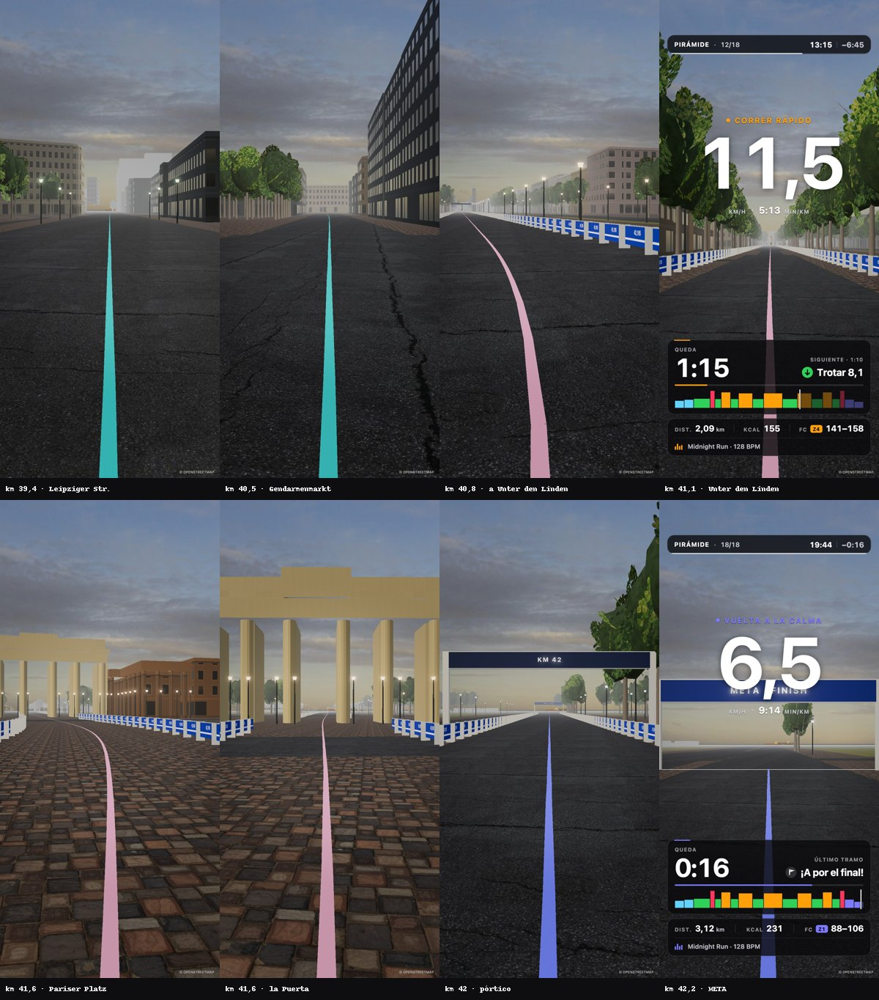
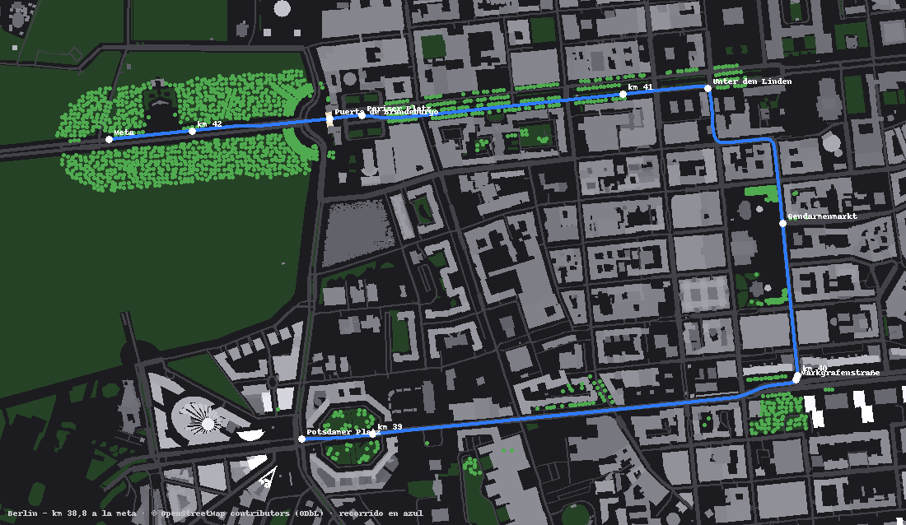
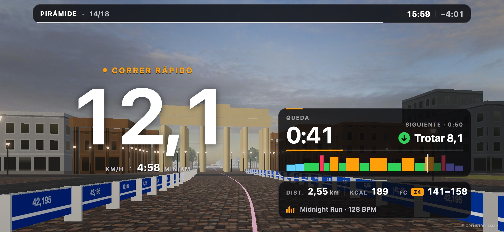
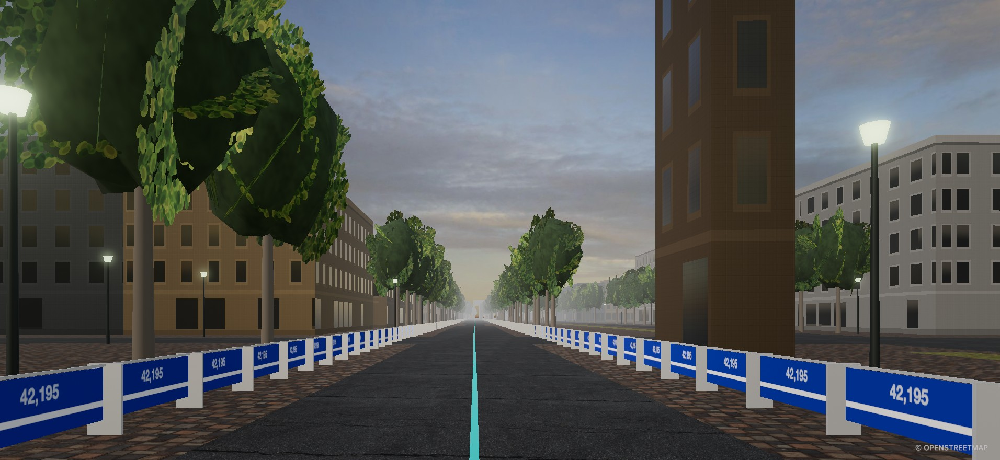
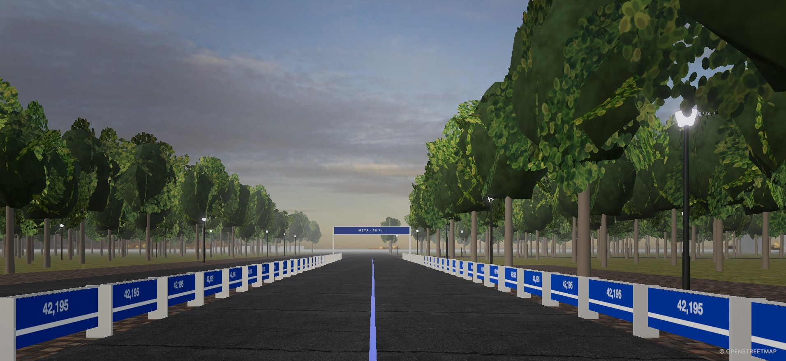
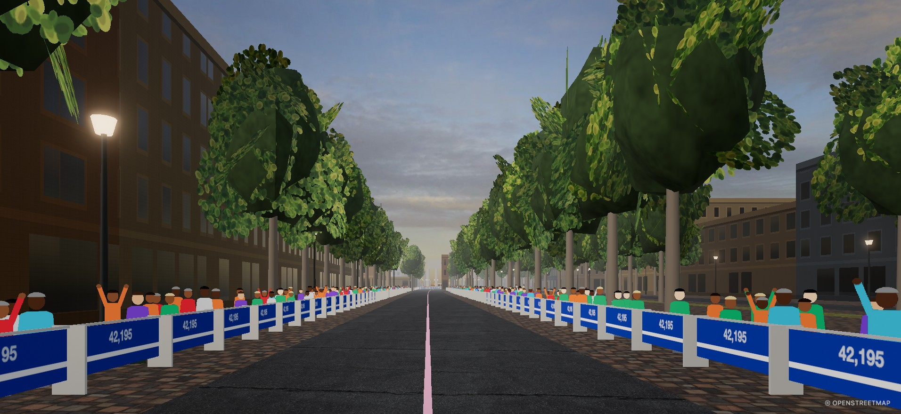
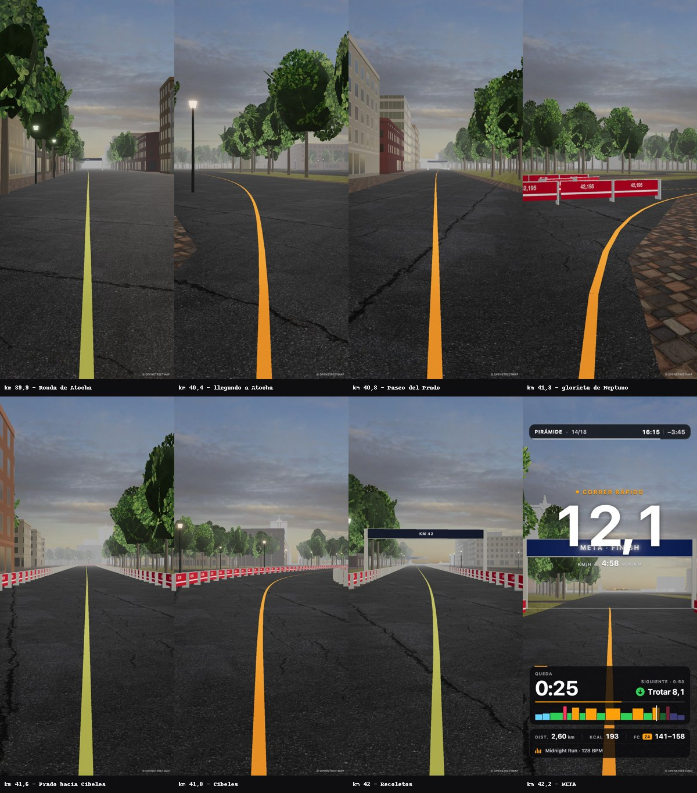
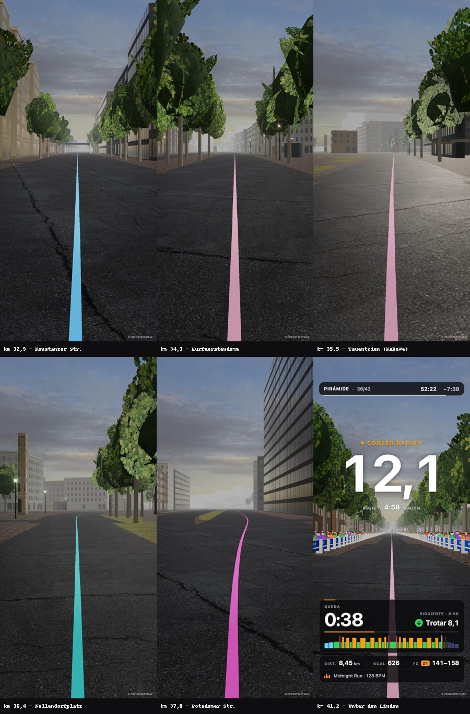

# Correr por ciudades y maratones reales · informe y prototipo

*2 de noviembre de 2026 · prototipos «ciudad-berlin» y «ciudad-madrid» (ocultos) en el laboratorio 3D*

## En una frase

**Se puede hacer gratis, sin claves y ligero en el iPhone horneando OpenStreetMap.** El prototipo recorre los
últimos 3,4 km del Maratón de Berlín a tu velocidad real: Leipziger Straße, Gendarmenmarkt, Unter den Linden,
la Puerta de Brandeburgo y la meta. Pesa **190 KB comprimido**, no llama a ninguna API mientras corres y va a 60 fps
en el laboratorio. Google Photorealistic 3D Tiles sería lo más realista, pero **no funciona con una cuenta de
España**: devuelve 403 en el EEE desde julio de 2025. Además prohíbe guardar los datos en caché.

## 1. Opciones comparadas (datos de hoy)

| Opción | ¿Vale para una app gratis publicada? | Coste | iPhone | Realismo |
|---|---|---|---|---|
| **Google Photorealistic 3D Tiles** (Map Tiles API) | **No para nosotros.** Con facturación en el EEE responde 403 en proyectos creados o tocados después del 8 jul 2025 [G4]. Fuera del EEE exige clave y cuenta de facturación, el logo de Google, las atribuciones de cada tile y **prohíbe precargar, guardar o usar sin conexión** [G3]. Se puede pintar con three.js (3d-tiles-renderer + `GoogleCloudAuthPlugin`) [G5]. | Se cobra la sesión (root tileset, 3 h): 1.000 gratis al mes y luego **6 $/1000** [G1][G2] | Pesado: decenas de MB por km a pie de calle (estimación), con streaming continuo | ★★★★★ |
| **Street View** (tiles / Static / JS) | Mismo problema: en el EEE «No Use With any Map» [G4], sin caché y con clave y facturación | Tiles: 100k gratis y luego 2 $/1000. Static: 10k gratis y luego 7 $/1000 [G1] | Solo fotos (no hay 3D para correr dentro) | ★★★★ (foto) |
| **Mapillary** | **Sí.** Token de cliente gratis (con cuenta), imágenes **CC BY-SA 4.0** con uso comercial. Se pueden guardar citando autor y enlace [M1][M2] | Gratis. Límites amplios: 60.000/min en entidades, 50.000 tiles/día [M1] | Ligero si se usan pocas fotos | ★★★ irregular (fotos colaborativas de calidad y fechas desiguales). Sirve de «postal» o fondo, no de 3D |
| **OpenStreetMap horneado** (Overpass una vez → JSON) | **Sí.** ODbL: «© OpenStreetMap» visible y el JSON derivado se publica con la misma licencia [O2]. Overpass no se usa desde la app, solo para hornear [O1] | **0 €** | **190 KB gz por 3,4 km**, ~10 materiales y 82.000 triángulos de edificios | ★★★ (prototipo): huellas y alturas reales, fachadas genéricas |
| OSM Buildings (servicio) | Sí. Geometría ODbL; servicio gratis, aunque piden avisar si hay mucha carga [O3][O4] | 0 € | Igual que OSM | Igual que OSM. Mejor hornear nosotros |
| **Modelos 3D oficiales abiertos** | Sí: Berlín LoD2 (**dl-de/zero 2.0**, tejados reales) [B1]; Berlin 3D con mesh texturizado de 2023 (licencia de descarga) [B2]; NYC 3D Building Model (NYC Open Data) [N1]; España: **Catastro** (alturas por plantas) y **ortofoto PNOA, CC BY 4.0** [C1][C3] | 0 € | Hay que recortar y simplificar: son archivos de cientos de MB | ★★★★ (tejados reales; con ortofoto, el suelo de verdad) |
| **Cesium ion** | Plan Community **solo para uso personal o no comercial**: 1.000 sesiones Google al mes y 15 GB al mes. No resuelve lo del EEE [CE1] | 0 € → **149 $/mes** si hay ingresos | Streaming | ★★★★★ (si es Google) |
| Apple MapKit JS / Look Around | Muy generoso (250.000 vistas al día con tu cuenta de desarrollador) [A1], pero es **su vista**: no se mete dentro de nuestra escena three.js | 0 € | — | ★★★★ en su visor |
| Mapbox / ArcGIS | Necesitan token. Mapbox: 50.000 cargas al mes gratis [MB1]. ArcGIS: 2 M tiles al mes gratis [E1] | Gratis al principio, de pago al crecer | Streaming | ★★★ |

## 2. De dónde sale el recorrido y cómo va a tu velocidad

**Trazados.** Ningún maratón publica un GPX oficial con licencia. Berlín y Nueva York solo tienen mapa interactivo
[R1][R6]. Madrid tiene un PDF [R9]. En OSM **ningún** maratón de los tres tiene relación `route=running`
(consulta Overpass, 2 nov 2026). La vía limpia es **dibujarlo sobre las calles de OSM**: se marcan unos puntos
clave (cruces) siguiendo el mapa oficial y el script busca el camino más corto por las calles entre ellos.
Así el trazado es ODbL de principio a fin. El de Berlín (final): Potsdamer Platz → Leipziger Straße →
Markgrafenstraße (Gendarmenmarkt) → Behrenstraße y Charlottenstraße → Unter den Linden → Pariser Platz → Puerta
de Brandeburgo → meta en la Straße des 17. Juni, a la altura de la Yitzhak-Rabin-Straße [R2][R3][R4].
*El tramo Behrenstraße–Charlottenstraße está sin confirmar en las fuentes: hay que revisarlo con el mapa oficial
antes de publicar.*

**Sincronía con la clase.** El kit ya da `runner.S`, los metros reales recorridos (km/h ÷ 3,6 con la rampa de la
cinta). El escenario hace tres cosas con ese dato:

1. **Cruzas la meta en el último segundo.** Antes de empezar se conoce la distancia total de la clase,
   `D = runner.sigAt(timeline.totalSec)`. Si la ruta mide `L ≥ D`, la clase empieza en `L − D`. En la clase de
   prueba (pirámide de 20 min, 3,15 km) empiezas en el km 39,05 y la meta llega con la vuelta a la calma.
2. **El kilómetro real del maratón**: `km = 42,195 − (L − s)/1000`. Los pórticos «KM 40, 41, 42» están en su
   sitio real.
3. **Si la clase es más larga que la ruta**, el prototipo da media vuelta al final y vuelve. Para producto es
   mejor hornear rutas más largas: el maratón entero en trozos de ~2 km (~60 KB gz cada uno) que se cargan según
   avanza `S`. Y, como idea: **«tu maratón por entregas»**, en la que cada clase sigue donde acabó la anterior
   hasta completar los 42,195 km.

Las esquinas se resuelven así: la ciudad entera gira y se desplaza a tu alrededor (el rumbo sale de 14 m por
delante y 8 m por detrás de la ruta suavizada). La cámara del kit sigue mirando a −z, así que el HUD, el
seguimiento de cabeza y el plano final no cambian.

## 3. El prototipo

- **Escenarios** `ciudad-berlin` y `ciudad-madrid`, los dos con `hidden: true` en
  `js/player/scene3d/themes/index.js`. Comparten el código de `js/player/scene3d/themes/ciudad.js`: cada ciudad
  es una entrada de `CITIES` con sus datos y su aspecto (paleta de fachadas, sol a la hora de la carrera, vallas,
  tonos de las hojas). Siguen el contrato del núcleo (`createTheme` → `update` / `event` / `resize` /
  `dispose`) y usan el kit `runner.js`: encendido en cadena, ambiente por zona y plano final.
- **Datos**: `assets/world/ciudad/berlin-final/`, con 4.181 edificios y partes con su altura, 1.418 calles con
  su ancho, 333 zonas verdes, **635 árboles y 338 farolas en su posición real** (catastro de árboles de Berlín en
  OSM) y la ruta cada 2 m con sus marcas.
- **Horneado**: `node tools/ciudad/bake.mjs <berlin|madrid> <extracto.json> [nodos.json]`, con las consultas
  en `tools/ciudad/<ciudad>*.overpassql`. Se ejecuta una vez en el Mac (3–10 s). Además de los árboles reales,
  siembra árboles en los parques y bulevares que OSM no tiene uno a uno (rejilla de ~10 m, lejos de calles y
  edificios): +960 en Berlín (Tiergarten) y +922 en Madrid (Salón del Prado, Recoletos). Aplica la regla Simple 3D Buildings (si un edificio tiene partes, se dibujan las partes:
  así sale la Puerta con sus columnas) y quita todo lo que tape el recorrido.
- **Lo que se ve**:
  - **Calles**: asfalto con el ancho real, y aceras y plazas adoquinadas.
  - **Fachadas por estilo**. Las de obra (Altbau y revoco) tienen huecos con recercado claro, alféizar, cornisa,
    zócalo y escaparates en la planta baja; algunas ventanas llevan cortinas. Los edificios altos y modernos de
    Potsdamer y Leipziger Platz son de muro cortina de vidrio, con montantes y antepechos.
  - **La Puerta de Brandeburgo**, de arenisca.
  - **Tilos de Unter den Linden** con copa de hojas: tarjetas con una textura de hojas dibujada en la escena,
    con los tonos de finales de septiembre.
  - **Vallas azules del maratón** en los últimos ~2,2 km. Se abren en la Puerta.
  - **El sol es de la ciudad**: al girar en las esquinas cambia de lado. En Leipziger Straße lo tienes de cara y
    en Unter den Linden a la espalda.
  - **La línea azul del maratón** (la línea ideal que Berlín pinta de verdad), con **el color del tramo**.
  - **Pórticos KM y META**.
  - **El crédito «© OpenStreetMap»** en una esquina.
  - **Cielo** de mañana despejada (el de Costa), sin destellos ni warp.
- **Coste** (laboratorio, Mac): 60 fps en calidad alta, unas 40 mallas y **~270.000 triángulos** contando las
  instancias: edificios 82.000, vallas ~63.000 y árboles ~90.000. En calidad media o baja quita árboles.
  65 MB de memoria JS. Desde Madrid solo se dibujan los árboles a menos de 350 m de tu punto del recorrido (la
  ventana se rehace cada 25 m). En calidad media se dibuja 1 de cada 2 y en baja 1 de cada 3. **Falta medirlo en
  un iPhone real**: si no llega, el primer recorte serían las vallas, que hoy no bajan con la calidad.
- **Verlo**: `node tools/snap-server.mjs 8097` → `http://localhost:8097/tools/scene-lab.html?theme=ciudad-berlin&t=975`.
  Con `t` mueves el reloj de la clase: t=500 Gendarmenmarkt, t=800 Unter den Linden, t=975 la Puerta, t=1184 la meta.

| | |
|---|---|
|  |  |

**Novedades de esta tanda (las dos ciudades):**
- **Público detrás de las vallas**, cada vez más denso hacia la meta, en hasta tres filas. Son figuras recortadas
  dibujadas en la escena (8 personas con 2 posturas) que siempre miran a la cámara; algunas levantan los brazos a
  su ritmo. Unas 2 × 2 triángulos por persona: el coste es mínimo.
- **El letrero del pórtico no tapa tu número.** Si al acercarte pasa por detrás de la velocidad del HUD, se funde
  al 15 % mientras dura el cruce y luego vuelve.

Capturas verticales y horizontales: `capturas/`.

**Pendiente para que parezca de verdad** (de más a menos impacto):
1. Tejados y volúmenes del **LoD2 de Berlín** (dl-de/zero), en lugar de los tejados planos de OSM.
2. Fachadas: texturas CC0 propias por estilo, porque hoy todas usan el hormigón de Neón por debajo. Y relieve
   real de cornisas y balcones donde pasas cerca.
3. El público son figuras planas dibujadas: de cerca se nota. Faltaría variedad de cuerpos, ropa y algún cartel.
4. El cielo de foto sigue fijo respecto a ti: solo cubre ±80° y no puede girar en las esquinas. Haría falta un
   panorama de 360°.

*Una nota del laboratorio.* Con el panel del navegador en segundo plano, el bucle de render del núcleo no arranca
(`document.hidden`) y la escena se queda en negro hasta que el panel vuelve a estar visible. Es del entorno, no del
escenario: en primer plano va a 60 fps. Lo que sí era del escenario y está corregido: los tejados daban NaN en el
shader de ventanas, y eso dejaba la imagen en negro.

### Madrid · los últimos 3,7 km

- **Recorrido**: glorieta de Pirámides → Paseo de las Acacias → glorieta de Embajadores → Ronda de Valencia →
  Ronda de Atocha → glorieta de Carlos V (Atocha) → Paseo del Prado → glorieta de Neptuno → Cibeles → **meta en
  el Paseo de Recoletos, a la altura de la calle Almirante**. Son 3.737 m (km 38,46 → 42,195). La meta es la del maratón de 2026 según la prensa del 26 de abril
  [R7][R10]. El orden de calles de los últimos km sale de la prensa: ninguna fuente publica el trazado con
  kilómetros, y Moncloa describe otro final. **Hay que revisarlo con el plano oficial.**
- **Datos**: `assets/world/ciudad/madrid-final/` (1 MB, 318 KB comprimido), a partir de dos extractos de OSM
  (centro y oeste). Tiene 4.730 edificios y partes, 1.113 calles, 652 zonas verdes, 1.381 árboles (la mayoría
  sembrados), 192 farolas y las fuentes de Cibeles y Neptuno. Esas dos fuentes no están en OSM como fuente: se ponen a mano por coordenadas, con su pilón
  de piedra, el agua y un pedestal en el centro.
- **Aspecto propio**:
  - Fachadas en revocos claros, ocres, ladrillo visto, granito y algún rosa pálido.
  - Monumentos con su color: Palacio de Cibeles, Banco de España, Museo del Prado (ladrillo y piedra), estación
    de Atocha, Palacio de Buenavista.
  - Sol de finales de abril sobre las 10:30.
  - Vallas rojas desde el Paseo del Prado, y la línea del recorrido en rojo anaranjado (Madrid no la pinta: aquí
    solo sirve para el color del tramo).
- **Cambios en el código que sirven para las dos**:
  - Sin vallas en las curvas cerradas: en las glorietas cruzaban la calzada.
  - La red de calles solo usa la parte conectada principal y no entra en túneles: en Madrid el primer intento se
    metía por un paso subterráneo.
- **Verlo**: `…/tools/scene-lab.html?theme=ciudad-madrid&t=60`. Mapa: [mapa-madrid.png](mapa-madrid.png).
- **A mejorar en Madrid**:
  - La Cibeles y el Neptuno son un pilón con un pedestal, sin las esculturas.
  - Los edificios con nombre no destacan tanto como en la realidad: el Palacio de Cibeles debería tener su torre.
  - El Paseo del Prado es tan ancho que, desde el centro de la calzada, las fachadas quedan lejos y la bruma las
    apaga.
  - La clase de prueba de 20 min (3,15 km) ya cabe: empieza en el Paseo de las Acacias y cruzas la meta con el
    último segundo. Para clases más largas, ver «Clases largas» en la recomendación.

## 3 bis. ¿Y con imagen de verdad (fotos o vídeo de la calle)?

Sí se puede, con matices:

| Vía | Cómo se vería | Problema |
|---|---|---|
| **Mapillary, foto a foto** | Avanzas por fotos reales de la calle cada 3–10 m, con fundido entre una y otra y sincronizadas con `S` (cada foto tiene su posición GPS). En muchas calles hay fotos de 360° | Fotos colaborativas: cambian la cámara, la hora y el tiempo, y a veces hay huecos. A pie de calle se nota «a saltos» si no hay fotos densas. Peso: ~35 MB por 3,4 km a 1024 px cada 10 m (o en streaming desde su CDN). Necesita un **token gratis** (cuenta de Mapillary) |
| Street View / Google | Lo mejor en imagen | En el EEE no se puede usar con mapas, está prohibido guardarlo en caché y además es de pago (ver tabla) |
| Vídeo POV de la ruta | Como Kinomap o iFit: un vídeo que acelera o frena con tu velocidad | Los vídeos de YouTube tienen copyright. Habría que grabarlos o licenciarlos. Y **en la app no puede haber `<video>`** (rompe el audio), así que serían secuencias de fotogramas JPG: ~1–2 MB por cada 100 m |
| Híbrido | Las fotos de Mapillary proyectadas sobre los edificios 3D de OSM | Es lo más vistoso, pero da bastante trabajo. Para una segunda fase |

Lo más rápido para probarlo es un modo **«foto real» con Mapillary** sobre la misma ruta y la misma sincronía.
Solo hace falta un token de cliente gratis, y para eso el usuario tiene que crear la cuenta.

## 4. Recomendación

1. **Seguir con OSM horneado** como base de «Ciudades reales»: cero coste, sin claves ni cuentas, sin conexión
   (va a `br-world` como el resto) y ligero. Encaja con «el audio es sagrado»: no hay streaming compitiendo con la
   música.
2. **Madrid ya está hecho**, con el mismo código y sus propios datos: añadir una ciudad es una entrada en el
   script de horneado y otra en `CITIES`, más medio día de ajustes. Siguiente paso posible: la **ortofoto PNOA
   (CC BY 4.0)** como suelo real en Madrid y el **LoD2 de Berlín** para los tejados.
3. **Google 3D Tiles queda descartado** mientras la cuenta sea del EEE. Aunque no lo fuera, la prohibición de
   caché y el coste por sesión no encajan con una app gratis de 45 minutos sin conexión. **Mapillary**, como
   mucho, para fotos de «postal» en la pantalla de la clase (CC BY-SA, citando autor).
4. Antes de publicar: confirmar el trazado con el mapa oficial, medir en iPhone y añadir el crédito ODbL a
   `assets/world/CREDITS.md`. Nombres como «Maratón de Berlín» en la app: mejor «Berlín · los últimos 3 km», sin
   la marca del evento, por el mismo motivo que el cambio de nombre de BestRunning.

### Clases largas (50 minutos o más): hecho con Berlín · últimos 10 km

Una clase de 50 min a 10–12 km/h son **8–10 km**; una de 60 min, hasta 12. Ya está el prototipo:
**`ciudad-berlin-10k`**.

- **Recorrido** (10.635 m, km 31,56 → 42,195): Hohenzollerndamm → Konstanzer Straße → Kurfürstendamm (Olivaer
  Platz, la Gedächtniskirche) → Tauentzienstraße (el KaDeWe) → Wittenbergplatz → Kleiststraße → Nollendorfplatz →
  Bülowstraße → Potsdamer Straße → Potsdamer Platz, y desde ahí el final de siempre hasta la Puerta y la meta. El
  orden de calles sale de Marathon Handbook y berlin.de de 2026; no hay km oficiales por calle.
  [Mapa](mapa-berlin-10k.png).
- **Datos**: 9.816 edificios y partes, 4.852 calles, 808 zonas verdes, 3.221 árboles y 676 farolas, en **6 trozos
  de 2 km**: unos 700 KB comprimidos en total (de 60 a 145 KB por trozo). El corredor se descarga de una vez con
  una consulta Overpass de tipo `around` sobre la ruta (`tools/ciudad/berlin-10k*.overpassql`).
- **Carga por trozos** (`ciudad.js`):
  - Se descargan todos los trozos al elegir el escenario, pero cada uno solo se construye cuando queda a menos de
    1,3 km por delante. Se construye poco a poco: cede el paso cada 120 edificios, unos 4 ms por fotograma.
  - Si ya lo tienes encima (una captura o un salto del reloj), se termina de golpe.
  - Se suelta al quedar a 0,7 km por detrás.
  - Nunca hay más de 2–3 trozos cargados (como máximo 183.000 triángulos de edificios), sea cual sea la distancia.
- **Medido en el laboratorio** (clase de 60 min, simulada entera fotograma a fotograma):
  - Es una pirámide de 9,48 km: empieza en el km 32,7 y cruza la meta con el último segundo.
  - El peor fotograma de construcción fue de 8,4 ms en el Mac; la media, 0,02 ms.
  - **Falta medirlo en un iPhone.** Allí esos 8 ms pueden ser 20–30, y si se nota habría que bajar el reparto a
    60 edificios por paso.
- **Madrid** también va ya por trozos (3 de 1,25 km) para probar el cargador con otra ciudad.
- **Para el maratón entero** (42 km) bastaría con más puntos clave y un corredor más largo. Serían 21 trozos y
  unos 3 MB en total. **«El maratón por entregas»** consistiría en guardar en el perfil dónde acabaste y empezar ahí
  la clase siguiente.

**No se ha creado ninguna cuenta ni clave, ni se ha publicado nada.** Los cambios están en local, sin commit.

## Fuentes

- [G1] https://developers.google.com/maps/billing-and-pricing/pricing
- [G2] https://developers.google.com/maps/documentation/tile/usage-and-billing
- [G3] https://developers.google.com/maps/documentation/tile/policies
- [G4] https://developers.google.com/maps/comms/eea/map-tiles
- [G5] https://gkjohnson.github.io/tools/docs/3d-tiles-renderer/core/plugins/GoogleCloudAuthPlugin/
- [M1] https://www.mapillary.com/developer/api-documentation · [M2] https://help.mapillary.com/hc/en-us/articles/115001770409
- [O1] https://wiki.openstreetmap.org/wiki/Overpass_API · [O2] https://www.openstreetmap.org/copyright
- [O3] https://osmbuildings.org/copyright/ · [O4] https://github.com/OSMBuildings/OSMBuildings/blob/master/docs/server.md
- [B1] https://gdi.berlin.de/geonetwork/srv/api/records/3c7c49af-00a4-3bcd-bc00-20e7f0f1b7bf
- [B2] https://www.businesslocationcenter.de/en/economic-atlas/download-portal
- [N1] https://github.com/CityOfNewYork/nyc-geo-metadata/blob/main/Metadata/Metadata_3DBuildingModel.md
- [C1] https://www.catastro.hacienda.gob.es/webinspire/index.html · [C3] https://ideas.asturias.es/w/ortofoto-pnoa-2021
- [CE1] https://cesium.com/pricing/ · [A1] https://developer.apple.com/forums/thread/782750
- [MB1] https://www.mapbox.com/pricing · [E1] https://location.arcgis.com/pricing/
- [R1] https://www.bmw-berlin-marathon.com/en/press
- [R2] https://www.berlin.de/en/news/10648366-5559700-preparations-for-berlin-marathon-first-r.en.html
- [R3] https://marathonhandbook.com/berlin-marathon-course-mile-by-mile/ · [R4] https://www.runinternational.eu/germany/1251-berlin-marathon
- [R6] https://goandrace.com/en/running-events/tcs-new-york-city-marathon-2024.php
- [R7] https://www.democrata.es/comunidad-de-madrid/claves-recorrido-maraton-madrid-2026-horarios-calles-cortadas-hoy/
- [R9] https://rocknrollmadridrun.com/wp-content/uploads/2025/01/recorrido_madrid_maraton_42K_2025.pdf
- [R10] https://madridinforma.es/?p=50199 (meta en Recoletos, a la altura de la calle Almirante) · https://www.marathons.com/es/maraton-de-madrid/asi-es-el-recorrido-del-maraton-de-madrid_l0l9

Datos del prototipo © colaboradores de OpenStreetMap (ODbL 1.0). Texturas y cielos CC0 de Poly Haven,
reutilizados de Neón, Costa y Bosque.
